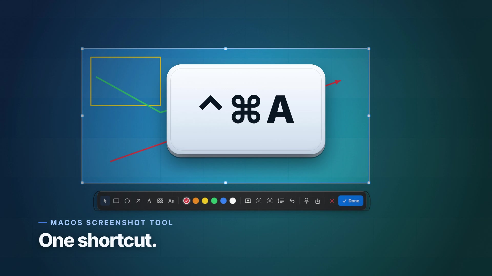

# Shotjoy（截趣）

**Capturas de pantalla, con alegría.**

[](https://www.apple.com/macos/) [](https://swift.org) [](https://github.com/JesseWeb/Shotjoy/releases) [](LICENSE)



[English](README.md) · [简体中文](README.zh-CN.md) · [繁體中文](README.zh-TW.md) · [日本語](README.ja.md) · [Français](README.fr.md) · **[Español](README.es.md)**

Shotjoy（截趣）es una herramienta de captura de pantalla para macOS rápida y
totalmente local, compilada localmente con Xcode: captura de región o ventana,
anotaciones, captura con desplazamiento, fijar en el escritorio, OCR local,
detección de códigos QR y enmascarado de caras con IA. Vive en la barra de menús,
no tiene icono en el Dock y no envía nada por la red.

> Palabras clave: captura de pantalla macOS, anotación de capturas, captura con
> desplazamiento, fijar captura, OCR, código QR, privacidad.

Pulsa **⌃⌘A** (Control-Command-A), arrastra una región o haz clic en una ventana,
añade anotaciones y luego copia, guarda o fija la captura en el escritorio.

## Descarga

[**Última versión →**](https://github.com/JesseWeb/Shotjoy/releases/latest)

El DMG de la release está firmado ad-hoc (sin notarizar). En el primer inicio,
haz clic derecho en Shotjoy → **Abrir** → **Abrir**, y concede el permiso
**Grabación de pantalla**. También puedes compilarla tú mismo: la app
llevará tu propia firma.

## Funciones

- **Atajo global** — `⌃⌘A` por defecto, configurable en Ajustes. Usa Carbon
  `RegisterEventHotKey`, sin permiso de Accesibilidad.
- **Superposición a pantalla completa** — escritorio atenuado, selección
  iluminada, ocho tiradores, cruz, lupa de píxeles, color y coordenadas en vivo.
- **Captura de ventana** — resalta la ventana superior al pasar el ratón; haz clic
  para capturarla.
- **Anotaciones** — mover/seleccionar, rectángulo, elipse, flecha, pincel,
  mosaico, texto, deshacer, paleta visible de seis colores y enmascarado de caras
  con IA (con aviso «no se detectaron caras» en vez de fallar en silencio).
- **Copiar / guardar / fijar** — `⌘C`, `⌘S` o el botón de fijar. Las capturas
  fijadas flotan sobre todas las apps; se pueden copiar, guardar, arrastrar y
  cerrar con clic derecho.
- **Captura con desplazamiento** — selecciona una región, pulsa la herramienta de
  desplazamiento, desplaza la página y pulsa Listo. Los fotogramas se alinean y
  unen localmente.
- **OCR y códigos QR** — Apple Vision, todo en el dispositivo: reconoce texto o
  un código QR/código de barras y copia el resultado.
- **Varias pantallas** — captura cada pantalla a resolución Retina nativa y admite
  selecciones que cruzan pantallas.
- **App de barra de menús** — `LSUIElement`, inicio al iniciar sesión, sin icono
  en el Dock.
- **Seis idiomas de interfaz** — inglés, chino simplificado, chino tradicional,
  japonés, francés y español; sigue el sistema por defecto y se cambia en
  Ajustes.

## Requisitos

- macOS 14 Sonoma o posterior (API ScreenCaptureKit)
- Xcode 15+ con el SDK de macOS (`xcodebuild -version` debe funcionar)
- Sin dependencias de terceros, sin registro de paquetes, sin red en ejecución

## Compilar e instalar

```sh
git clone https://github.com/JesseWeb/Shotjoy.git ~/Developer/Shotjoy
cd ~/Developer/Shotjoy
swift test                       # pruebas de geometría y unión
./scripts/make-app.sh release    # -> dist/Shotjoy.app
cp -R dist/Shotjoy.app /Applications/
open /Applications/Shotjoy.app
```

Crear un DMG para arrastrar a Aplicaciones:

```sh
./scripts/make-dmg.sh release    # -> dist/Shotjoy-1.0.3.dmg
```

`make-app.sh` elige la identidad de firma disponible: `SHOTJOY_SIGN_IDENTITY`,
luego Developer ID, Apple Development y finalmente ad-hoc. El DMG se firma con
la misma identidad cuando es posible. La notarización es opcional y está
documentada en [`docs/distribution.md`](docs/distribution.md).

## Primer inicio: permiso de grabación de pantalla

macOS solo permite conceder la Grabación de pantalla desde Ajustes del Sistema.
En la primera captura, Shotjoy la solicita y abre:

**Ajustes del Sistema → Privacidad y seguridad → Grabación de pantalla**

Activa **Shotjoy** y vuelve a capturar. Algunas versiones de macOS requieren
cerrar y volver a abrir Shotjoy después de conceder el permiso.

Si el interruptor ya está activado pero Shotjoy sigue pidiendo permiso, la firma
habrá cambiado (habitual en compilaciones ad-hoc). Usa **icono de la barra de
menús → Reparar permiso de grabación de pantalla…** y vuelve a concederlo. La app
ejecuta `tccutil reset ScreenCapture` para su bundle y reabre el panel.

## Uso

| Acción | Cómo |
|---|---|
| Capturar | `⌃⌘A` o clic izquierdo en el icono de la barra de menús |
| Seleccionar región | Arrastrar por la pantalla |
| Capturar una ventana | Clic en la ventana resaltada |
| Mover la selección | Elegir la herramienta mano/puntero (primer botón, activa por defecto) y arrastrar dentro |
| Redimensionar | Arrastrar uno de los ocho tiradores |
| Rectángulo / elipse / flecha / pincel / mosaico / texto | Elegir herramienta y arrastrar; vista previa en vivo |
| Cambiar color | Clic en una muestra; la activa tiene anillo blanco y marca |
| Deshacer | `⌘Z` o el botón deshacer |
| Copiar y cerrar | `Return`, `⌘C` o **Listo** |
| Guardar como PNG | `⌘S` o el botón guardar |
| Fijar en el escritorio | El botón de fijar |
| Cancelar | `Esc` o el botón cerrar |
| Captura con desplazamiento | Selección → herramienta desplazamiento → desplazar → Listo |
| OCR / QR | Botones de texto o QR de la barra de herramientas |
| Enmascarar caras con IA | Botón de cara de la barra de herramientas |
| Cambiar atajo | Icono de la barra de menús → Ajustes… → Grabar |
| Última captura | Icono de la barra de menús → Fijar / Guardar / Reconocer |

El icono de la barra de menús es un visor. Clic izquierdo para capturar, clic
derecho para el menú.

## Dónde se guardan los datos

Shotjoy casi no guarda nada:

- Preferencias: `~/Library/Preferences/dev.shotjoy.Shotjoy.plist`
- Capturas: solo donde las guardes (portapapeles por defecto)
- Elemento de inicio: `SMAppService`, con respaldo LaunchAgent
- Sin base de historial, sin subidas, sin analítica

Desinstalar:

```sh
pkill -x Shotjoy
rm -rf /Applications/Shotjoy.app
defaults delete dev.shotjoy.Shotjoy 2>/dev/null || true
tccutil reset ScreenCapture dev.shotjoy.Shotjoy
```

## Arquitectura

```
Sources/ShotjoyCore/          lógica pura, testeable sin servidor gráfico
  Geometry.swift               coordenadas globales, tiradores, límites
  Annotation.swift             modelo de anotación + pila de deshacer
  FrameStitcher.swift          búsqueda de solapamiento para capturas largas
  HotKey.swift                 modelo de atajo y nombres visibles
  ImageNaming.swift            nombres de PNG estables

Sources/Shotjoy/              app de barra de menús AppKit/SwiftUI
  AppDelegate.swift            ciclo de vida, captura, OCR/QR, permisos
  Services/
    ScreenCaptureService.swift ScreenCaptureKit + respaldo CoreGraphics
    CaptureSession.swift       máquina de estados de la superposición y render final
    WindowLocator.swift        ventana superior bajo el cursor
    ScrollingCaptureController.swift  captura y unión de fotogramas
    VisionAnalyzer.swift       OCR, códigos de barras y caras en local
    AnnotationRenderer.swift   dibujo compartido superposición/imagen final
    HotKeyManager.swift        atajo global Carbon
    StatusItemController.swift icono de la barra de menús
  Views/                       superposición, barra de herramientas, ajustes, HUD, vista previa
  Windows/                     ventana de superposición, panel de herramientas, panel fijado
```

## Opciones de desarrollo

Opciones ocultas para agentes y depuración:

```sh
open -a /Applications/Shotjoy.app --args --status        # escribe /tmp/shotjoy-status.txt
open -a /Applications/Shotjoy.app --args --self-test     # genera /tmp/shotjoy-render-test.png
open -a /Applications/Shotjoy.app --args --demo-overlay  # superposición sintética, sin permiso
open -a /Applications/Shotjoy.app --args --capture       # inicia una captura real
```

## Licencia

GNU AGPL-3.0. Ver [`LICENSE`](LICENSE).
