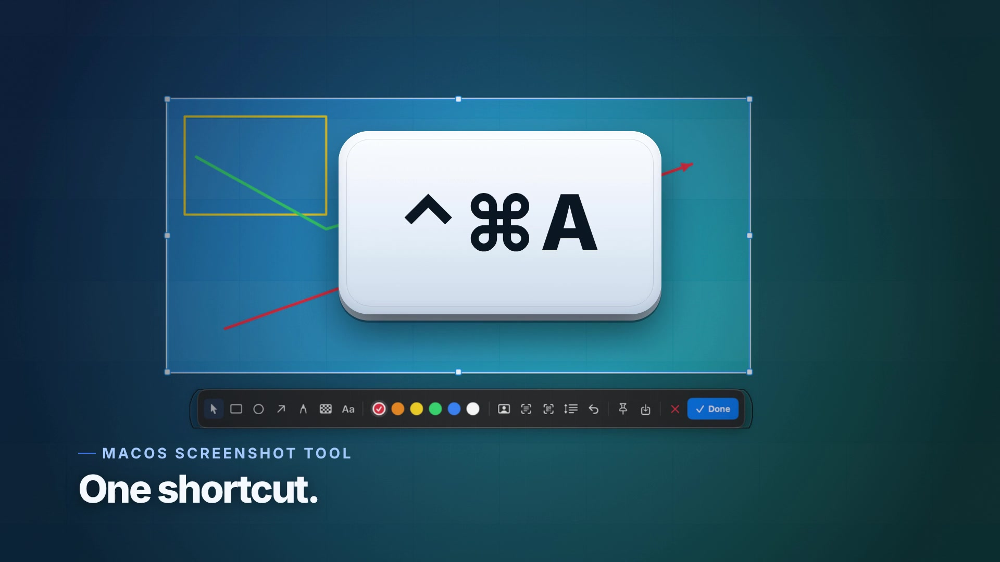

# Shotjoy（截趣）

**Des captures d'écran, avec plaisir.**

[](https://www.apple.com/macos/) [](https://swift.org) [](https://github.com/JesseWeb/Shotjoy/releases) [](LICENSE)



[English](README.md) · [简体中文](README.zh-CN.md) · [繁體中文](README.zh-TW.md) · [日本語](README.ja.md) · **[Français](README.fr.md)** · [Español](README.es.md)

Shotjoy（截趣）est un outil de capture d'écran macOS rapide et 100 % local,
compilé localement avec Xcode : capture de zone ou de fenêtre,
annotations, capture défilante, épinglage sur le bureau, OCR local, détection de
QR codes et masquage de visages par IA. Il vit dans la barre des menus, n'a pas
d'icône dans le Dock et n'envoie rien sur le réseau.

> Mots-clés : capture d'écran macOS, annotation de capture, capture défilante,
> épinglage, OCR, QR code, masquage de visages.

Appuyez sur **⌃⌘A** (Control-Command-A), faites glisser une zone ou cliquez une
fenêtre, annotez, puis copiez, enregistrez ou épinglez la capture sur le bureau.

## Installation

Trois façons d'installer Shotjoy. Choisissez-en une.

### 1. Télécharger le DMG

[**Dernière version →**](https://github.com/JesseWeb/Shotjoy/releases/latest)

Le DMG de la release est signé ad-hoc (non notarié). Au premier lancement,
faites un clic droit sur Shotjoy → **Ouvrir** → **Ouvrir**, puis accordez
l'autorisation **Enregistrement de l'écran**.

### 2. Compiler soi-même

```sh
git clone https://github.com/JesseWeb/Shotjoy.git ~/Developer/Shotjoy
cd ~/Developer/Shotjoy
swift test                       # tests géométrie/assemblage
./scripts/make-app.sh release    # -> dist/Shotjoy.app
cp -R dist/Shotjoy.app /Applications/
open /Applications/Shotjoy.app
```

`make-app.sh` choisit l'identité de signature disponible sur la machine :
`SHOTJOY_SIGN_IDENTITY`, puis Developer ID, puis Apple Development, puis ad-hoc.
Une compilation locale porte votre propre signature : l'autorisation
d'enregistrement de l'écran reste valide après un nouveau build. Pour une image
disque à glisser dans Applications, lancez `./scripts/make-dmg.sh release`
(→ `dist/Shotjoy-1.0.5.dmg`) ; la notarisation est facultative et décrite dans
[`docs/distribution.md`](docs/distribution.md).

### 3. Laisser un agent IA l'installer

Collez ceci dans Claude Code, Codex, Cursor, Gemini CLI ou OpenCode :

> Installe Shotjoy sur ce Mac : clone https://github.com/JesseWeb/Shotjoy dans
> ~/Developer/Shotjoy, suis AGENTS.md, lance `swift test` et
> `./scripts/make-app.sh release`, installe `dist/Shotjoy.app` dans
> /Applications et démarre-le, puis guide-moi pour l'autorisation
> **Enregistrement de l'écran** et vérifie une vraie capture ⌃⌘A collée dans
> TextEdit.

Les prompts complets en six langues sont dans
[`docs/ai-install.md`](docs/ai-install.md). L'agent peut compiler, installer et
vérifier, mais il ne peut pas activer l'enregistrement de l'écran : macOS
n'accepte cette autorisation que de votre part dans Réglages Système.

## Fonctionnalités

- **Raccourci global** — `⌃⌘A` par défaut, modifiable dans les réglages. Carbon
  `RegisterEventHotKey`, sans autorisation Accessibilité.
- **Overlay plein écran** — bureau assombri, sélection lumineuse, huit poignées
  de redimensionnement, réticule, loupe pixel, couleur et coordonnées en direct.
- **Capture de fenêtre** — survolez la fenêtre au premier plan, cliquez pour la
  capturer.
- **Annotations** — déplacement/sélection, rectangle, ellipse, flèche, pinceau,
  mosaïque, texte, annulation, palette de six couleurs et masquage de visages par
  IA (avec un toast « aucun visage détecté » au lieu d'un échec silencieux).
- **Copier / enregistrer / épingler** — `⌘C`, `⌘S` ou le bouton d'épingle. Les
  captures épinglées flottent au-dessus de toutes les apps ; copie, enregistrement,
  déplacement et fermeture par clic droit.
- **Capture défilante** — sélectionnez une zone, cliquez l'outil de défilement,
  faites défiler la page, puis cliquez Terminé. Les images sont alignées et
  assemblées localement.
- **OCR et QR codes** — Apple Vision, entièrement sur l'appareil : reconnaît le
  texte ou un QR code/code-barres et copie le résultat.
- **Multi-écran** — capture chaque écran en résolution Retina native et accepte
  les sélections qui traversent plusieurs écrans.
- **App de barre des menus** — `LSUIElement`, lancement à l'ouverture de session,
  pas d'icône dans le Dock.
- **Six langues d'interface** — anglais, chinois simplifié, chinois traditionnel,
  japonais, français et espagnol ; suit le système par défaut et se change dans
  les réglages.

## Prérequis

- macOS 14 Sonoma ou plus récent (API ScreenCaptureKit)
- Xcode 15+ avec le SDK macOS, uniquement pour compiler
  (`xcodebuild -version` doit fonctionner)
- Aucune dépendance tierce, aucun registre de paquets, aucun réseau à l'exécution

## Premier lancement : autorisation d'enregistrement de l'écran

macOS n'autorise l'enregistrement de l'écran que depuis Réglages Système. À la
première capture, Shotjoy demande l'autorisation et ouvre :

**Réglages Système → Confidentialité et sécurité → Enregistrement de l'écran**

Activez **Shotjoy**, puis recommencez la capture. Certaines versions de macOS
demandent de quitter et relancer Shotjoy après l'autorisation.

Si l'interrupteur est déjà activé mais que Shotjoy redemande l'autorisation, la
signature a probablement changé (fréquent en ad-hoc). Utilisez **icône de la
barre des menus → Réparer l'autorisation d'enregistrement de l'écran…**, puis
autorisez à nouveau. L'app exécute `tccutil reset ScreenCapture` pour son
identifiant et rouvre le panneau.

## Utilisation

| Action | Comment |
|---|---|
| Capturer | `⌃⌘A`, ou clic gauche sur l'icône de la barre des menus |
| Sélectionner une zone | Faire glisser sur l'écran |
| Capturer une fenêtre | Cliquer la fenêtre mise en évidence |
| Déplacer la sélection | Choisir l'outil main/pointeur (premier bouton, actif par défaut), puis glisser dans la sélection |
| Redimensionner | Faire glisser l'une des huit poignées |
| Rectangle / ellipse / flèche / pinceau / mosaïque / texte | Choisir un outil, puis glisser ; aperçu en direct |
| Changer la couleur | Cliquer une pastille ; la couleur active a un anneau blanc et une coche |
| Annuler | `⌘Z` ou le bouton annuler |
| Copier et fermer | `Return`, `⌘C` ou **Terminé** |
| Enregistrer en PNG | `⌘S` ou le bouton enregistrer |
| Épingler sur le bureau | Le bouton d'épingle |
| Annuler la capture | `Esc` ou le bouton fermer |
| Capture défilante | Sélection → outil défilement → défiler → Terminé |
| OCR / QR code | Boutons texte ou QR code de la barre d'outils |
| Masquage de visages IA | Bouton visage de la barre d'outils |
| Changer le raccourci | Icône de la barre des menus → Réglages… → Enregistrer |
| Dernière capture | Icône de la barre des menus → Épingler / Enregistrer / Reconnaître |

L'icône de la barre des menus est un viseur. Clic gauche pour capturer, clic
droit pour le menu.

## Où sont les données

Shotjoy ne stocke presque rien :

- Préférences : `~/Library/Preferences/dev.shotjoy.Shotjoy.plist`
- Captures : uniquement où vous les enregistrez (presse-papiers par défaut)
- Élément de connexion : `SMAppService`, avec repli LaunchAgent
- Aucune base d'historique, aucun envoi, aucune analytique

Désinstallation :

```sh
pkill -x Shotjoy
rm -rf /Applications/Shotjoy.app
defaults delete dev.shotjoy.Shotjoy 2>/dev/null || true
tccutil reset ScreenCapture dev.shotjoy.Shotjoy
```

## Architecture

```
Sources/ShotjoyCore/          logique pure, testable sans serveur graphique
  Geometry.swift               coordonnées globales, poignées, limites
  Annotation.swift             modèle d'annotation + pile d'annulation
  FrameStitcher.swift          recherche de chevauchement pour captures longues
  HotKey.swift                 modèle de raccourci et noms d'affichage
  ImageNaming.swift            noms de fichiers PNG stables

Sources/Shotjoy/              app de barre des menus AppKit/SwiftUI
  AppDelegate.swift            cycle de vie, capture, OCR/QR, autorisations
  Services/
    ScreenCaptureService.swift ScreenCaptureKit + repli CoreGraphics
    CaptureSession.swift       machine d'état de l'overlay et rendu final
    WindowLocator.swift        fenêtre au premier plan sous le curseur
    ScrollingCaptureController.swift  capture et assemblage des images
    VisionAnalyzer.swift       OCR, codes-barres et visages en local
    AnnotationRenderer.swift   dessin partagé overlay/image finale
    HotKeyManager.swift        raccourci global Carbon
    StatusItemController.swift icône de la barre des menus
  Views/                       overlay, barre d'outils, réglages, HUD, aperçu
  Windows/                     fenêtre overlay, panneau barre d'outils, épingle
```

## Options de développement

Options cachées pour les agents et le débogage :

```sh
open -a /Applications/Shotjoy.app --args --status        # écrit /tmp/shotjoy-status.txt
open -a /Applications/Shotjoy.app --args --self-test     # génère /tmp/shotjoy-render-test.png
open -a /Applications/Shotjoy.app --args --demo-overlay  # overlay synthétique, sans autorisation
open -a /Applications/Shotjoy.app --args --capture       # démarre une vraie capture
open -a /Applications/Shotjoy.app --args --window-pick-test  # vérifie la capture par clic sur une fenêtre
```

## Licence

GNU AGPL-3.0. Voir [`LICENSE`](LICENSE).
