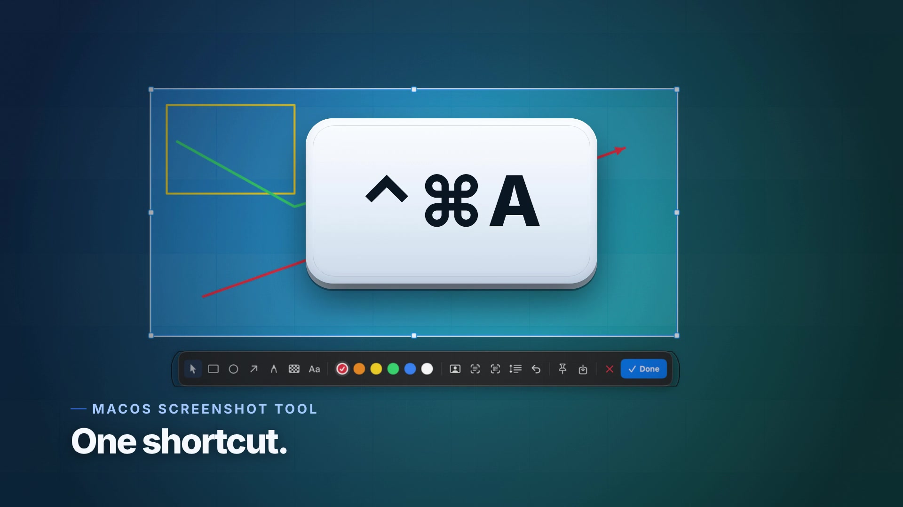

# Shotjoy（截趣）

**スクリーンショットをもっと楽しく。**

[](https://www.apple.com/macos/) [](https://swift.org) [](https://github.com/JesseWeb/Shotjoy/releases) [](LICENSE)



[English](README.md) · [简体中文](README.zh-CN.md) · [繁體中文](README.zh-TW.md) · **[日本語](README.ja.md)** · [Français](README.fr.md) · [Español](README.es.md)

Shotjoy（截趣）は高速でローカル完結の macOS スクリーンショットツールです。Xcode を
使ってローカルでビルドでき、範囲/ウィンドウ撮影、注釈、スクロール撮影、デスクトップ
へのピン留め、ローカル OCR、QR コード認識、AI 顔マスキングを備えます。
メニューバー常駐型で Dock アイコンはなく、ネットワークへ何も送信しません。

> 検索キーワード：macOS スクリーンショット、画面キャプチャ、注釈、スクロール撮影、
> ピン留め、OCR、QR コード、AI 顔マスキング。

**⌃⌘A**（Control-Command-A）を押し、範囲をドラッグするか、ウィンドウや
デスクトップをクリックすると画面全体を撮影できます。注釈を付けたらコピー・
保存・デスクトップへのピン留めができます。

## インストール

3 つの方法から選べます。

### 1. DMG をダウンロード

[**最新 Release →**](https://github.com/JesseWeb/Shotjoy/releases/latest)

Release の DMG は ad-hoc 署名（未公証）です。初回起動時は Shotjoy を右クリック
→ **開く** → **開く** を選び、その後「画面収録」を許可してください。

### 2. 自分でビルド

```sh
git clone https://github.com/JesseWeb/Shotjoy.git ~/Developer/Shotjoy
cd ~/Developer/Shotjoy
swift test                       # コアの幾何/結合テスト
./scripts/make-app.sh release    # -> dist/Shotjoy.app
cp -R dist/Shotjoy.app /Applications/
open /Applications/Shotjoy.app
```

`make-app.sh` は `SHOTJOY_SIGN_IDENTITY`、Developer ID、Apple Development、
ad-hoc の順で利用可能な署名 ID を選びます。自分でビルドした App には自分の署名が
付くため、再ビルド後も「画面収録」の許可が維持されます。Applications へ
ドラッグできる DMG は `./scripts/make-dmg.sh release`
（→ `dist/Shotjoy-1.0.7.dmg`）で作成でき、公証は任意です
（[`docs/distribution.md`](docs/distribution.md)）。

### 3. AI エージェントに任せる

Claude Code、Codex、Cursor、Gemini CLI、OpenCode のいずれかに次を貼り付けます。

> この Mac に Shotjoy をインストールしてください：https://github.com/JesseWeb/Shotjoy
> を ~/Developer/Shotjoy にクローンし、リポジトリの AGENTS.md に従って
> `swift test` と `./scripts/make-app.sh release` を実行、`dist/Shotjoy.app` を
> /Applications にコピーして起動してください。その後「システム設定 →
> プライバシーとセキュリティ → 画面収録」の許可を案内し、実際に ⌃⌘A で撮影して
> TextEdit に貼り付けるところまで確認してください。

6 言語の完全なプロンプトは [`docs/ai-install.md`](docs/ai-install.md) にあります。
AI はビルド・インストール・確認まで行えますが、「画面収録」のスイッチは
切り替えられません。macOS はシステム設定での手動許可だけを受け付けます。

## 機能

- **グローバルショートカット** — 既定は `⌃⌘A`。設定で変更可能。Carbon の
  `RegisterEventHotKey` を使用し、アクセシビリティ権限は不要です。
- **全画面オーバーレイ** — デスクトップを暗くし、選択範囲を明るく表示。8 つの
  リサイズハンドル、十字カーソル、ピクセル拡大鏡、色と座標のリアルタイム表示。
- **ウィンドウ撮影** — マウスを重ねると最前面のウィンドウを強調し、クリックで撮影。
- **注釈** — 移動/選択、矩形、楕円、矢印、ブラシ、モザイク、テキスト、元に戻す、
  6 色パレット、AI 顔マスキング（顔が見つからない場合はトーストで通知）。
- **コピー / 保存 / ピン留め** — `⌘C`、`⌘S`、またはピンボタン。ピン留めした画像は
  すべての App の上に浮かび、コピー・保存・ドラッグ・右クリックで閉じられます。
- **スクロール撮影** — 範囲を選び、スクロールツールを押してページをスクロールし、
  完了を押します。フレームはローカルで位置合わせして結合します。
- **OCR と QR コード** — Apple Vision を利用し、すべてオンデバイスで実行。
  スクリーンショット内の文字や QR コード/バーコードを認識してコピーします。
- **マルチディスプレイ** — 各ディスプレイをネイティブ Retina 解像度で撮影し、
  画面をまたぐ選択にも対応します。
- **メニューバー App** — `LSUIElement`、ログイン時に起動、Dock アイコンなし。
- **6 言語の UI** — 英語、簡体字中国語、繁体字中国語、日本語、フランス語、スペイン語。既定ではシステムに従い、設定で変更できます。

## 動作環境

- macOS 14 Sonoma 以降（ScreenCaptureKit のスクリーンショット API）
- Xcode 15+ と macOS SDK（ソースからビルドする場合のみ。
  `xcodebuild -version` が動作すること）
- サードパーティ依存なし、パッケージレジストリなし、実行時のネットワーク通信なし

## 初回起動：画面収録の権限

macOS では「画面収録」をシステム設定でユーザーが許可する必要があります。
最初の撮影時に Shotjoy が権限を要求し、次の画面を開きます：

**システム設定 → プライバシーとセキュリティ → 画面収録**

**Shotjoy** をオンにして、もう一度撮影してください。macOS のバージョンによっては
Shotjoy の再起動が必要です。

スイッチがオンなのに権限を求められる場合は、署名が変わった可能性があります
（ad-hoc ビルドでよくあります）。メニューバーのアイコン → **画面収録の権限を
修復…** を選び、再許可してください。App は自分の Bundle ID に対して
`tccutil reset ScreenCapture` を実行し、設定画面を開きます。

## 使い方

| 操作 | 方法 |
|---|---|
| 撮影 | `⌃⌘A`、またはメニューバーアイコンを左クリック |
| 範囲選択 | 画面上をドラッグ |
| ウィンドウ撮影 | 強調されたウィンドウをクリック |
| 選択範囲を移動 | ハンド/ポインタツール（ツールバー先頭、既定で選択）を選び、範囲内をドラッグ |
| 選択範囲をリサイズ | 8 つのハンドルのいずれかをドラッグ |
| 矩形 / 楕円 / 矢印 / ブラシ / モザイク / テキスト | ツールを選んでドラッグ。描画中もリアルタイムでプレビュー |
| 色を変更 | カラースウォッチをクリック。選択中の色には白いリングとチェックが付く |
| 元に戻す | `⌘Z` または元に戻すボタン |
| コピーして閉じる | `Return`、`⌘C`、または「完了」 |
| PNG で保存 | `⌘S` または保存ボタン |
| デスクトップにピン留め | ピンボタン |
| キャンセル | `Esc` または閉じるボタン |
| スクロール撮影 | 範囲選択 → スクロールツール → スクロール → 完了 |
| OCR / QR コード | ツールバーの文字認識または QR コードボタン |
| AI 顔マスキング | ツールバーの顔マスキングボタン |
| ショートカット変更 | メニューバーアイコン → 設定… → 記録 |
| 直前のスクリーンショット | メニューバーアイコン → ピン留め / 保存 / 文字認識 |

メニューバーのアイコンはビューファインダーです。左クリックで撮影を開始し、
右クリックでメニューを開きます。

## データの保存場所

Shotjoy はほとんど何も保存しません：

- 設定：`~/Library/Preferences/dev.shotjoy.Shotjoy.plist`
- スクリーンショット：保存した場所のみ（既定ではクリップボード）
- ログイン項目：`SMAppService`、失敗時は LaunchAgent にフォールバック
- 履歴データベース、アップロード、解析はありません

アンインストール：

```sh
pkill -x Shotjoy
rm -rf /Applications/Shotjoy.app
defaults delete dev.shotjoy.Shotjoy 2>/dev/null || true
tccutil reset ScreenCapture dev.shotjoy.Shotjoy
```

## アーキテクチャ

```
Sources/ShotjoyCore/          純粋なロジック。ウィンドウサーバーなしでテスト可能
  Geometry.swift               グローバル座標、選択ハンドル、境界制限
  Annotation.swift             注釈モデル + 元に戻すスタック
  FrameStitcher.swift          長いスクリーンショットの行シグネチャ重なり検索
  HotKey.swift                 ショートカットモデルと表示名
  ImageNaming.swift            安定した PNG ファイル名

Sources/Shotjoy/              AppKit/SwiftUI メニューバー App
  AppDelegate.swift            ライフサイクル、撮影フロー、OCR/QR、権限
  Services/
    ScreenCaptureService.swift ScreenCaptureKit + CoreGraphics フォールバック
    CaptureSession.swift       オーバーレイ状態機械と最終レンダリング
    WindowLocator.swift        カーソル下の最前面ウィンドウ
    ScrollingCaptureController.swift  フレーム取得と結合
    VisionAnalyzer.swift       ローカル OCR、バーコード、顔検出
    AnnotationRenderer.swift   オーバーレイ/最終画像の共通描画
    HotKeyManager.swift        Carbon グローバルショートカット
    StatusItemController.swift メニューバーアイテム
  Views/                       オーバーレイ、ツールバー、設定、HUD、プレビュー
  Windows/                     オーバーレイ、ツールバーパネル、ピンパネル
```

## 開発用フラグ

Agent とデバッグ用の隠しフラグ：

```sh
open -a /Applications/Shotjoy.app --args --status        # /tmp/shotjoy-status.txt に書き込み
open -a /Applications/Shotjoy.app --args --self-test     # /tmp/shotjoy-render-test.png を生成
open -a /Applications/Shotjoy.app --args --demo-overlay  # 合成オーバーレイ、権限不要
open -a /Applications/Shotjoy.app --args --capture       # 実際の撮影を開始
open -a /Applications/Shotjoy.app --args --window-pick-test  # ウインドウのクリック撮影を検証
```

## ライセンス

GNU AGPL-3.0。[`LICENSE`](LICENSE) を参照。
