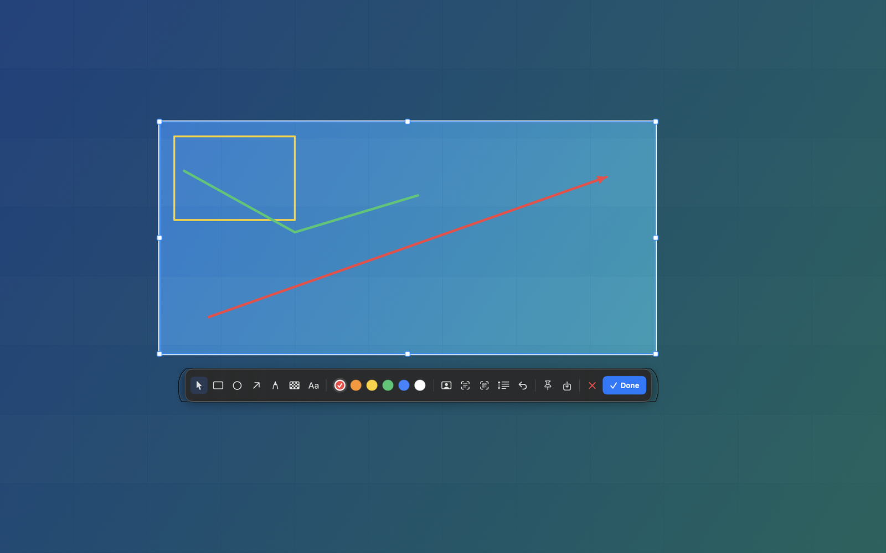

# ShotDesk

A WeChat-style screenshot tool for macOS, built from source with SwiftPM.

Press **⌃⌘A** (Control-Command-A), drag a region or click a window, annotate it,
then copy, save, or pin it to the desktop. ShotDesk lives in the menu bar and
has no Dock icon and no network code.



## Features

- **Global shortcut** — `⌃⌘A` by default, changeable in Settings. Carbon
  `RegisterEventHotKey`, no Accessibility permission needed.
- **Full-screen overlay** — dimmed desktop, bright selection, eight resize
  handles, crosshair, pixel magnifier, live colour/coordinate readout.
- **Window capture** — hover highlights the topmost window; click captures it.
- **Annotations** — move/select, rectangle, ellipse, arrow, freehand brush,
  mosaic brush, text, undo, a visible six-colour swatch palette, and AI face
  masking (with a "no faces detected" toast instead of a silent no-op).
- **Copy / save / pin** — `⌘C`, `⌘S`, or the pin button. Pinned shots float on
  top of all apps and can be copied, saved, dragged, or closed with a right-click.
- **Scrolling screenshot** — select a region, click the scroll tool, scroll the
  page, then click Done. Frames are aligned and stitched locally.
- **OCR and QR** — Apple Vision, fully on-device: recognize text or a QR/barcode
  in the shot, copy the result.
- **Multi-display** — captures every display at native Retina resolution and
  supports selections that cross displays.
- **Menu-bar app** — `LSUIElement`, launch-at-login, no Dock icon.

## Requirements

- macOS 14 Sonoma or newer (ScreenCaptureKit screenshot API)
- Xcode 15+ with the macOS SDK (`xcodebuild -version` must work)
- No third-party dependencies, no package registry, no network at runtime

## Build and install

```sh
git clone <this repository> ~/Developer/ShotDesk
cd ~/Developer/ShotDesk
swift test                       # core geometry/stitching tests
./scripts/make-app.sh release    # -> dist/ShotDesk.app
cp -R dist/ShotDesk.app /Applications/
open /Applications/ShotDesk.app
```

Build a drag-to-Applications disk image:

```sh
./scripts/make-dmg.sh release    # -> dist/ShotDesk-1.0.0.dmg
```

`make-app.sh` picks the signing identity available on the build machine:
`SHOTDESK_SIGN_IDENTITY`, then Developer ID, then Apple Development, then
ad-hoc. The DMG is signed with the same identity when possible. Notarization is
optional and documented in [`docs/distribution.md`](docs/distribution.md).

## First run: Screen Recording permission

macOS only lets a user grant Screen Recording in System Settings. On first
capture ShotDesk asks for it and opens:

**System Settings → Privacy & Security → Screen Recording**

Switch **ShotDesk** on, then capture again. Some macOS builds require quitting
and reopening ShotDesk after the grant.

If the switch is already on but ShotDesk still asks, the build's signature
changed (common with ad-hoc builds). Use **menu-bar icon → Fix Screen Recording
Permission…**, then grant again. The app runs `tccutil reset ScreenCapture` for
its own bundle id and reopens the pane.

## Usage

| Action | How |
|---|---|
| Capture | `⌃⌘A`, or left-click the menu-bar icon |
| Select region | Drag anywhere |
| Capture a window | Click the highlighted window |
| Move selection | Select the hand/pointer tool (the first toolbar button, active by default), then drag inside the selection |
| Resize selection | Drag one of the eight handles |
| Rectangle / ellipse / arrow / brush / mosaic / text | Pick a tool, then drag; the stroke is previewed live |
| Change drawing colour | Click a colour swatch; the selected one gets a white ring and checkmark |
| Undo | `⌘Z` or the undo button |
| Copy and close | `Return`, `⌘C`, or **Done** |
| Save as PNG | `⌘S` or the save button |
| Pin to desktop | The pin button |
| Cancel | `Esc` or the close button |
| Scrolling screenshot | Select region → scroll tool → scroll → Done |
| OCR / QR | The scan menu in the toolbar |
| AI mask faces | The face button in the toolbar |
| Change shortcut | Menu-bar icon → Settings… → Record |
| Last screenshot | Menu-bar icon → Pin / Save / Recognize |

The menu-bar icon shows a viewfinder. Left-click starts a capture; right-click
opens the menu.

## Where things live

ShotDesk stores almost nothing:

- Preferences: `~/Library/Preferences/dev.shotdesk.ShotDesk.plist`
- Screenshots: only where you save them (clipboard by default)
- Login item: `SMAppService`, with a LaunchAgent fallback
- No history database, no uploads, no analytics

Uninstall:

```sh
pkill -x ShotDesk
rm -rf /Applications/ShotDesk.app
defaults delete dev.shotdesk.ShotDesk 2>/dev/null || true
tccutil reset ScreenCapture dev.shotdesk.ShotDesk
```

## Architecture

```
Sources/ShotDeskCore/          pure logic, testable without a window server
  Geometry.swift               global coordinates, selection handles, clamping
  Annotation.swift             annotation model + undo stack
  FrameStitcher.swift          row-signature overlap search for long screenshots
  HotKey.swift                 shortcut model and display names
  ImageNaming.swift            stable PNG file names

Sources/ShotDesk/              AppKit/SwiftUI menu-bar app
  AppDelegate.swift            lifecycle, capture flow, OCR/QR, permissions
  Services/
    ScreenCaptureService.swift ScreenCaptureKit + CoreGraphics fallback
    CaptureSession.swift       overlay state machine and final renderer
    WindowLocator.swift        topmost window under the pointer
    ScrollingCaptureController.swift  grab frames and stitch
    VisionAnalyzer.swift       local OCR, barcode and face detection
    AnnotationRenderer.swift   shared overlay/final drawing
    HotKeyManager.swift        Carbon global hotkey
    StatusItemController.swift menu-bar item
  Views/                       overlay, toolbar, settings, HUD, preview
  Windows/                     overlay window, toolbar panel, pin panel
```

### How it relates to WeChat

See [`docs/reverse-engineering.md`](docs/reverse-engineering.md). In short, the
shipped WeChat 4.1.5 binary contains `weshot::ScreenShoter`,
`weshot::LongScreenShoter`, `GrabWorker`, `SpliceWorker`, `OpenCVWorker`,
`SizeSelect`, `ColorPanel`, `PinWindow`, and a selection state machine named
`ShotSelection`. ShotDesk is a clean-room implementation of the same observable
workflow using public macOS APIs. It contains no WeChat code, assets, icons, or
data formats.

## Verification status

See [`STATUS.md`](STATUS.md). Core tests, rendering, bundle signing, DMG layout,
the Retina capture pipeline, the live hotkey overlay, selection/toolbar, live
pen preview, and OCR end-to-end are verified. A manual pass for pin, scrolling
capture, QR and AI masking is still useful.

## Development flags

Hidden flags for agents and debugging:

```sh
open -a /Applications/ShotDesk.app --args --status        # writes /tmp/shotdesk-status.txt
open -a /Applications/ShotDesk.app --args --self-test     # renders /tmp/shotdesk-render-test.png
open -a /Applications/ShotDesk.app --args --demo-overlay  # synthetic overlay, no permission needed
open -a /Applications/ShotDesk.app --args --capture       # start a real capture
```

## License

GNU AGPL-3.0. See [`LICENSE`](LICENSE). This is a clean-room project; do not
copy WeChat code or assets into it.
