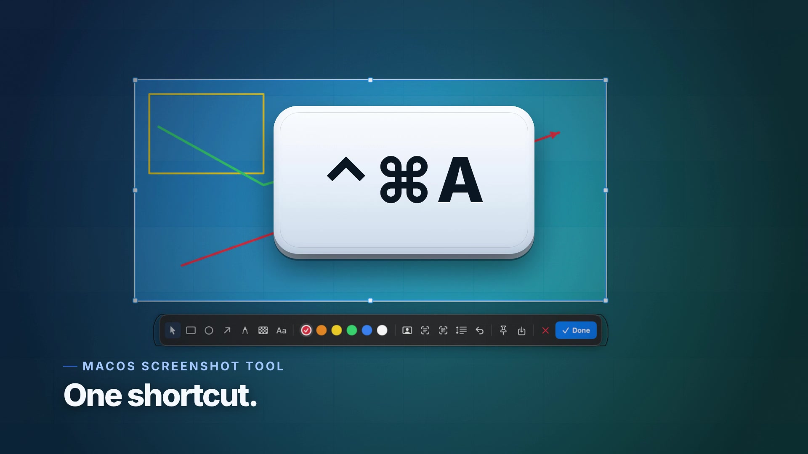

# Shotjoy（截趣）

**截图，也可以很有趣。**

[](https://www.apple.com/macos/) [](https://swift.org) [](https://github.com/JesseWeb/Shotjoy/releases) [](LICENSE)



[English](README.md) · **[简体中文](README.zh-CN.md)** · [繁體中文](README.zh-TW.md) · [日本語](README.ja.md) · [Français](README.fr.md) · [Español](README.es.md)

Shotjoy（截趣）是一款快速、纯本地的 macOS 截图工具，使用 Xcode 在本机编译：
支持区域/窗口截图、截图标注、滚动截图、桌面贴图、本地 OCR、二维码识别和
AI 人脸打码。它只住在菜单栏，没有 Dock 图标，也不会把任何内容发送到网络。

> 搜索关键词：macOS 截图工具、截图标注、滚动截图、贴图、文字识别、二维码识别、
> 屏幕截图、Mac 截图。

按 **⌃⌘A**（Control-Command-A），拖动选择区域、单击窗口，或单击桌面截取整屏；
完成标注后复制、保存或贴到桌面。

## 安装

三种方式，任选其一。

### 1. 下载 DMG

[**最新 Release →**](https://github.com/JesseWeb/Shotjoy/releases/latest)

Release 里的 DMG 使用 ad-hoc 签名（未公证）。首次启动请右键 Shotjoy →
**打开** → **打开**，然后授予「屏幕录制」权限。

### 2. 自行编译

```sh
git clone https://github.com/JesseWeb/Shotjoy.git ~/Developer/Shotjoy
cd ~/Developer/Shotjoy
swift test                       # 核心几何/拼接测试
./scripts/make-app.sh release    # -> dist/Shotjoy.app
cp -R dist/Shotjoy.app /Applications/
open /Applications/Shotjoy.app
```

`make-app.sh` 会按顺序选择签名身份：`SHOTJOY_SIGN_IDENTITY`、Developer ID、
Apple Development、ad-hoc。自己编译的 App 会带上你自己的签名，重新编译后
「屏幕录制」授权也不会失效。想做成可拖入「应用程序」的 DMG，执行
`./scripts/make-dmg.sh release`（→ `dist/Shotjoy-1.0.6.dmg`）；公证是可选项，
详见 [`docs/distribution.md`](docs/distribution.md)。

### 3. 交给 AI 安装

把下面这段发给 Claude Code、Codex、Cursor、Gemini CLI 或 OpenCode：

> 在这台 Mac 上安装 Shotjoy：把 https://github.com/JesseWeb/Shotjoy 克隆到
> ~/Developer/Shotjoy，按仓库里的 AGENTS.md 执行 `swift test` 和
> `./scripts/make-app.sh release`，把 `dist/Shotjoy.app` 安装到 /Applications
> 并启动，然后引导我在「系统设置 → 隐私与安全性 → 屏幕录制」中授权，最后
> 实际按 ⌃⌘A 截图并粘贴到 TextEdit 验证。

六种语言的完整提示词在 [`docs/ai-install.md`](docs/ai-install.md)。AI 能完成
编译、安装和验证，但无法替你打开「屏幕录制」开关——macOS 只接受你在系统设置里
手动授权。

## 功能

- **全局快捷键** — 默认 `⌃⌘A`，可在设置中修改。使用 Carbon
  `RegisterEventHotKey`，不需要辅助功能权限。
- **全屏覆盖层** — 桌面变暗、选区高亮、八个缩放控制点、十字准星、像素放大镜、
  实时颜色和坐标显示。
- **窗口截图** — 鼠标悬停时高亮最上层窗口，单击即可截取。
- **标注** — 移动/选择、矩形、椭圆、箭头、画笔、马赛克、文字、撤销、可见的
  六色色板，以及 AI 人脸打码（未检测到人脸时会明确提示，而不是静默失败）。
- **复制 / 保存 / 贴图** — `⌘C`、`⌘S` 或贴图按钮。贴图会悬浮在所有 App 之上，
  可复制、保存、拖动，右键关闭。
- **滚动截图** — 选择区域，点击滚动工具，滚动页面，然后点完成。帧在本地对齐并拼接。
- **OCR 和二维码** — 使用 Apple Vision，全程本地：识别截图中的文字或二维码/条码，
  并复制结果。
- **多显示器** — 以原生 Retina 分辨率截取每块屏幕，支持跨屏选区。
- **菜单栏应用** — `LSUIElement`，支持开机启动，没有 Dock 图标。
- **六种界面语言** — 英文、简体中文、繁体中文、日文、法文、西班牙文；默认跟随系统，可在设置中切换。

## 系统要求

- macOS 14 Sonoma 或更新（ScreenCaptureKit 截图 API）
- Xcode 15+ 和 macOS SDK，仅在自行编译时需要（`xcodebuild -version` 必须可用）
- 无第三方依赖、无包管理器、无运行时网络访问

## 首次运行：屏幕录制权限

macOS 只允许用户在系统设置中授予「屏幕录制」。第一次截图时，Shotjoy 会请求
权限并打开：

**系统设置 → 隐私与安全性 → 屏幕录制**

打开 **Shotjoy** 的开关，然后重新截图。部分 macOS 版本需要退出并重新打开
Shotjoy 才会生效。

如果开关已经打开但 Shotjoy 仍然提示权限，通常是签名变化（ad-hoc 构建常见）。
点击菜单栏图标 → **修复屏幕录制权限…**，然后重新授权。App 会为自己的
Bundle ID 执行 `tccutil reset ScreenCapture` 并重新打开设置页。

## 使用

| 操作 | 方法 |
|---|---|
| 截图 | `⌃⌘A`，或左键单击菜单栏图标 |
| 选择区域 | 在屏幕上拖动 |
| 截取窗口 | 单击高亮的窗口 |
| 移动选区 | 选择手形/指针工具（工具栏第一个按钮，默认选中），在选区内拖动 |
| 缩放选区 | 拖动八个控制点之一 |
| 矩形 / 椭圆 / 箭头 / 画笔 / 马赛克 / 文字 | 选择工具后拖动；绘制过程实时预览 |
| 修改颜色 | 点击色板圆点；当前颜色会显示白圈和对勾 |
| 撤销 | `⌘Z` 或撤销按钮 |
| 复制并关闭 | `Return`、`⌘C` 或「完成」 |
| 保存为 PNG | `⌘S` 或保存按钮 |
| 贴到桌面 | 贴图按钮 |
| 取消 | `Esc` 或关闭按钮 |
| 滚动截图 | 选择区域 → 滚动工具 → 滚动 → 完成 |
| OCR / 二维码 | 工具栏的文字识别或二维码按钮 |
| AI 人脸打码 | 工具栏的人脸打码按钮 |
| 修改快捷键 | 菜单栏图标 → 设置… → 录制 |
| 上一张截图 | 菜单栏图标 → 贴图 / 保存 / 识别文字 |

菜单栏图标是取景框。左键开始截图，右键打开菜单。

## 数据位置

Shotjoy 几乎不保存东西：

- 偏好设置：`~/Library/Preferences/dev.shotjoy.Shotjoy.plist`
- 截图：只保存在你选择的位置（默认复制到剪贴板）
- 登录项：`SMAppService`，失败时回退到 LaunchAgent
- 没有历史数据库、没有上传、没有统计

卸载：

```sh
pkill -x Shotjoy
rm -rf /Applications/Shotjoy.app
defaults delete dev.shotjoy.Shotjoy 2>/dev/null || true
tccutil reset ScreenCapture dev.shotjoy.Shotjoy
```

## 架构

```
Sources/ShotjoyCore/          纯逻辑，无需窗口服务器即可测试
  Geometry.swift               全局坐标、选区控制点、边界约束
  Annotation.swift             标注模型 + 撤销栈
  FrameStitcher.swift          长截图的行签名重叠匹配
  HotKey.swift                 快捷键模型和显示名称
  ImageNaming.swift            稳定的 PNG 文件名

Sources/Shotjoy/              AppKit/SwiftUI 菜单栏 App
  AppDelegate.swift            生命周期、截图流程、OCR/二维码、权限
  Services/
    ScreenCaptureService.swift ScreenCaptureKit + CoreGraphics 回退
    CaptureSession.swift       覆盖层状态机和最终渲染
    WindowLocator.swift        鼠标下最上层窗口
    ScrollingCaptureController.swift  抓帧和拼接
    VisionAnalyzer.swift       本地 OCR、条码和人脸检测
    AnnotationRenderer.swift   覆盖层/最终图共用绘制
    HotKeyManager.swift        Carbon 全局快捷键
    StatusItemController.swift 菜单栏图标
  Views/                       覆盖层、工具栏、设置、HUD、预览
  Windows/                     覆盖层窗口、工具栏面板、贴图面板
```

## 开发调试参数

给 Agent 和调试使用的隐藏参数：

```sh
open -a /Applications/Shotjoy.app --args --status        # 写入 /tmp/shotjoy-status.txt
open -a /Applications/Shotjoy.app --args --self-test     # 渲染 /tmp/shotjoy-render-test.png
open -a /Applications/Shotjoy.app --args --demo-overlay  # 合成覆盖层，无需权限
open -a /Applications/Shotjoy.app --args --capture       # 立即开始真实截图
open -a /Applications/Shotjoy.app --args --window-pick-test  # 验证点击窗口即可截取该窗口
```

## 许可证

GNU AGPL-3.0。见 [`LICENSE`](LICENSE)。
