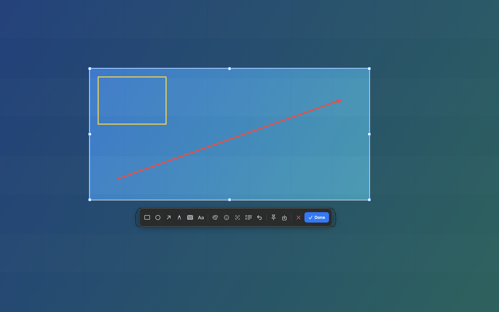

# Shotjoy（截趣）

**截圖，也可以很有趣。**

[](https://www.apple.com/macos/) [](https://swift.org) [](https://github.com/JesseWeb/Shotjoy/releases) [](LICENSE)



[English](README.md) · [简体中文](README.zh-CN.md) · **[繁體中文](README.zh-TW.md)** · [日本語](README.ja.md) · [Français](README.fr.md) · [Español](README.es.md)

Shotjoy（截趣）是一款快速、純本地的 macOS 截圖工具，使用 Xcode 在本機編譯：
支援區域/視窗截圖、截圖標註、捲動截圖、桌面貼圖、本機 OCR、QR Code 辨識與
AI 人臉打碼。它只住在選單列，沒有 Dock 圖示，也不會把任何內容傳到網路。

> 搜尋關鍵字：macOS 截圖工具、截圖標註、捲動截圖、貼圖、文字辨識、QR Code 辨識、
> 螢幕截圖、Mac 截圖。

按 **⌃⌘A**（Control-Command-A），拖曳選取範圍或按一下視窗，完成標註後複製、
儲存或貼到桌面。

## 下載

[**最新 Release →**](https://github.com/JesseWeb/Shotjoy/releases/latest)

Release 中的 DMG 使用 ad-hoc 簽章（未公證）。首次啟動請右鍵 Shotjoy →
**打開** → **打開**，然後授予「螢幕錄製」權限。也可以自行編譯，這樣 App
會帶上你自己的簽章。

## 功能

- **全域快速鍵** — 預設 `⌃⌘A`，可在設定中修改。使用 Carbon
  `RegisterEventHotKey`，不需要輔助使用權限。
- **全螢幕覆蓋層** — 桌面變暗、選取範圍高亮、八個縮放控制點、十字準星、
  像素放大鏡、即時顏色與座標顯示。
- **視窗截圖** — 滑鼠移過時高亮最上層視窗，按一下即可截取。
- **標註** — 移動/選取、矩形、橢圓、箭頭、畫筆、馬賽克、文字、復原、可見的
  六色色盤，以及 AI 人臉打碼（沒有人臉時會明確提示，不會靜默失敗）。
- **複製 / 儲存 / 貼圖** — `⌘C`、`⌘S` 或貼圖按鈕。貼圖會浮在所有 App 之上，
  可複製、儲存、拖曳，右鍵關閉。
- **捲動截圖** — 選取範圍，按一下捲動工具，捲動頁面，然後按完成。畫格會在本機
  對齊並拼接。
- **OCR 與 QR Code** — 使用 Apple Vision，全程本機：辨識截圖中的文字或
  QR Code/條碼，並複製結果。
- **多螢幕** — 以原生 Retina 解析度截取每個螢幕，支援跨螢幕選取。
- **選單列 App** — `LSUIElement`，支援開機啟動，沒有 Dock 圖示。
- **六種介面語言** — 英文、簡體中文、繁體中文、日文、法文、西班牙文；預設跟隨系統，可在設定中切換。

## 系統需求

- macOS 14 Sonoma 或更新（ScreenCaptureKit 截圖 API）
- Xcode 15+ 與 macOS SDK（`xcodebuild -version` 必須可用）
- 無第三方相依套件、無套件管理器、無執行時網路存取

## 建置與安裝

```sh
git clone https://github.com/JesseWeb/Shotjoy.git ~/Developer/Shotjoy
cd ~/Developer/Shotjoy
swift test                       # 核心幾何/拼接測試
./scripts/make-app.sh release    # -> dist/Shotjoy.app
cp -R dist/Shotjoy.app /Applications/
open /Applications/Shotjoy.app
```

建置可拖進「應用程式」的 DMG：

```sh
./scripts/make-dmg.sh release    # -> dist/Shotjoy-1.0.2.dmg
```

`make-app.sh` 會依序選擇簽章身分：`SHOTJOY_SIGN_IDENTITY`、Developer ID、
Apple Development、ad-hoc。DMG 也會盡量使用相同身分簽章。公證是選項，
詳見 [`docs/distribution.md`](docs/distribution.md)。

## 首次執行：螢幕錄製權限

macOS 只允許使用者在系統設定中授予「螢幕錄製」。第一次截圖時，Shotjoy 會請求
權限並開啟：

**系統設定 → 隱私權與安全性 → 螢幕錄製**

開啟 **Shotjoy** 的開關，然後重新截圖。部分 macOS 版本需要結束並重新開啟
Shotjoy 才會生效。

如果開關已開啟但 Shotjoy 仍提示權限，通常是簽章變更（ad-hoc 建置常見）。
按一下選單列圖示 → **修復螢幕錄製權限…**，然後重新授權。App 會為自己的
Bundle ID 執行 `tccutil reset ScreenCapture` 並重新開啟設定頁。

## 使用方式

| 操作 | 方法 |
|---|---|
| 截圖 | `⌃⌘A`，或左鍵按一下選單列圖示 |
| 選取範圍 | 在螢幕上拖曳 |
| 截取視窗 | 按一下高亮的視窗 |
| 移動選取範圍 | 選擇手形/指標工具（工具列第一個按鈕，預設選取），在範圍內拖曳 |
| 縮放選取範圍 | 拖曳八個控制點之一 |
| 矩形 / 橢圓 / 箭頭 / 畫筆 / 馬賽克 / 文字 | 選擇工具後拖曳；繪製過程即時預覽 |
| 修改顏色 | 按一下色盤圓點；目前顏色會顯示白圈與勾勾 |
| 復原 | `⌘Z` 或復原按鈕 |
| 複製並關閉 | `Return`、`⌘C` 或「完成」 |
| 儲存為 PNG | `⌘S` 或儲存按鈕 |
| 貼到桌面 | 貼圖按鈕 |
| 取消 | `Esc` 或關閉按鈕 |
| 捲動截圖 | 選取範圍 → 捲動工具 → 捲動 → 完成 |
| OCR / QR Code | 工具列的文字辨識或 QR Code 按鈕 |
| AI 人臉打碼 | 工具列的人臉打碼按鈕 |
| 修改快速鍵 | 選單列圖示 → 設定… → 錄製 |
| 上一張截圖 | 選單列圖示 → 貼圖 / 儲存 / 辨識文字 |

選單列圖示是取景框。左鍵開始截圖，右鍵開啟選單。

## 資料位置

Shotjoy 幾乎不儲存東西：

- 偏好設定：`~/Library/Preferences/dev.shotjoy.Shotjoy.plist`
- 截圖：只儲存在你選擇的位置（預設複製到剪貼簿）
- 登入項目：`SMAppService`，失敗時回退到 LaunchAgent
- 沒有歷史資料庫、沒有上傳、沒有統計

解除安裝：

```sh
pkill -x Shotjoy
rm -rf /Applications/Shotjoy.app
defaults delete dev.shotjoy.Shotjoy 2>/dev/null || true
tccutil reset ScreenCapture dev.shotjoy.Shotjoy
```

## 架構

```
Sources/ShotjoyCore/          純邏輯，無需視窗伺服器即可測試
  Geometry.swift               全域座標、選取範圍控制點、邊界限制
  Annotation.swift             標註模型 + 復原堆疊
  FrameStitcher.swift          長截圖的列簽章重疊比對
  HotKey.swift                 快速鍵模型與顯示名稱
  ImageNaming.swift            穩定的 PNG 檔名

Sources/Shotjoy/              AppKit/SwiftUI 選單列 App
  AppDelegate.swift            生命週期、截圖流程、OCR/QR Code、權限
  Services/
    ScreenCaptureService.swift ScreenCaptureKit + CoreGraphics 回退
    CaptureSession.swift       覆蓋層狀態機與最終渲染
    WindowLocator.swift        滑鼠下最上層視窗
    ScrollingCaptureController.swift  擷取畫格與拼接
    VisionAnalyzer.swift       本機 OCR、條碼與人臉偵測
    AnnotationRenderer.swift   覆蓋層/最終圖共用繪製
    HotKeyManager.swift        Carbon 全域快速鍵
    StatusItemController.swift 選單列圖示
  Views/                       覆蓋層、工具列、設定、HUD、預覽
  Windows/                     覆蓋層視窗、工具列面板、貼圖面板
```

## 開發偵錯參數

給 Agent 與除錯使用的隱藏參數：

```sh
open -a /Applications/Shotjoy.app --args --status        # 寫入 /tmp/shotjoy-status.txt
open -a /Applications/Shotjoy.app --args --self-test     # 渲染 /tmp/shotjoy-render-test.png
open -a /Applications/Shotjoy.app --args --demo-overlay  # 合成覆蓋層，無需權限
open -a /Applications/Shotjoy.app --args --capture       # 立即開始真實截圖
```

## 授權條款

GNU AGPL-3.0。見 [`LICENSE`](LICENSE)。
